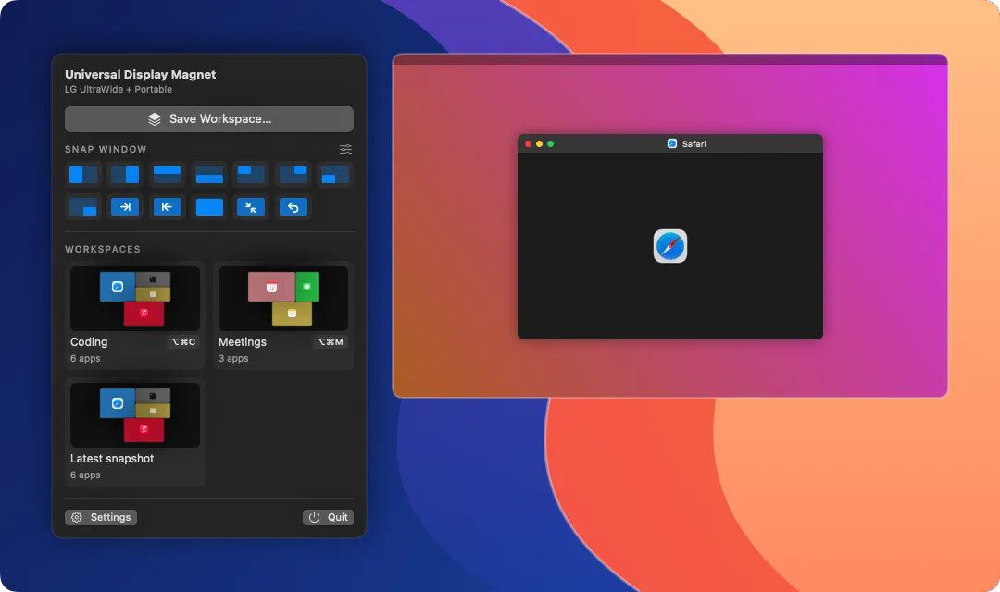

# Universal Display Magnet


<p align="center">
  
</p>

**Your displays, windows and Macs, exactly where you left them.**

Universal Display Magnet is a native macOS app that snaps your monitors together and keeps them that way. It arranges Universal Control across your Macs properly, saves every window's monitor and Desktop as workspaces, snaps windows like Magnet, and keeps all of it in sync between your Macs.

Built with Swift and SwiftUI. No account, no cloud service, no analytics.

[Getting started](#getting-started) · [Features](#features) · [Compatibility](#compatibility) · [Building](#building-from-source)

> Independent, community-developed software, not affiliated with or endorsed by Apple. Universal Control arrangement uses a private macOS framework and was developed and verified on macOS 27.

## Why this app?

macOS shuffles displays when they wake, piles windows onto whatever screen is left when one disconnects, and won't let you place displays flush in its arrangement sheets. That's especially true for Universal Control, where two Macs' displays drift apart or overlap.

Universal Display Magnet fixes the arrangement once and puts it back every time. Monitors snap edge to edge, the Universal Control layout is written directly, and windows return to the monitor and Desktop they were on. With two Macs, one keeps the other's arrangement and workspaces in sync over your local network. Nothing to pair.

## Features

| | What you can do |
| --- | --- |
| **Display arrangement** | Drag displays in a visual editor; they snap flush against each other and line up edges and centres. Place one against a free edge with the arrows, type exact positions, nudge with the arrow keys, pick the main display. **Apply** previews live with a 15-second keep/revert countdown. |
| **Snap displays together** | One click pulls every display flush against its neighbours, with no gaps or overlaps. |
| **Stays put** | Arrangements are saved per set of monitors (identified by EDID serial, so two identical monitors are told apart) and re-applied whenever they reconnect, wake or get shuffled by macOS. Works without a built-in display (Mac Studio, Mac mini, clamshell). Resolutions can be restored too. |
| **Universal Control arrangement** | See both Macs' displays where Universal Control has them, drag the other Mac's displays (or any of yours) and they snap flush across both Macs. The arrangement is applied straight into Universal Control, live on both Macs, with an undo. |
| **Workspaces** | Save your monitor arrangement plus every app's windows: which monitor, which Desktop or full-screen Space, and where. A drawn preview shows each window in its app's colour, per Desktop. Choose which apps to include, set a shortcut, restore in one go (missing apps are opened). |
| **Automatic snapshots** | Window positions are recorded every few minutes and as the screens go to sleep, then restored when a monitor setup reconnects or the Mac wakes with its displays changed. |
| **Window snapping** | Magnet's commands with Magnet's shortcuts: halves, quarters, next/previous display, maximize, centre and restore. Add your own: draw any size and position on a grid. Drag a window to a screen edge or corner to snap it, with a preview. |
| **Sync between Macs** | Arrangements, workspaces and each Mac's displays sync directly over Wi-Fi, Ethernet or a Thunderbolt cable, encrypted, with no cloud. Your Macs recognise each other through Universal Control; nothing to pair. Arrange the other Mac's own displays from this one. |
| **Universal Control activity and reset** | An **Activity** page shows, in plain words, what Universal Control does with your other Mac: Bluetooth signal dropouts, connections, arrangement changes and input it had to throw away. When it stops working, **Reset Universal Control** restarts its services on both Macs over your network and puts your arrangement back. |
| **Wake the other Mac** | When this Mac wakes or you unlock it, your other Mac's display turns on too (Wake-on-LAN if it's fully asleep). While the other Mac's screens are asleep, **Wake Other Mac** appears in the menu bar. |
| **Menu bar and Dock** | Snap buttons, Save Workspace and your workspaces (with previews, two per row) from the menu bar; workspaces in the Dock menu. |
| **18 languages** | English, Čeština, Deutsch, Español, Français, Italiano, Magyar, Nederlands, Polski, Português (Brasil), Svenska, Türkçe, Русский, Українська, 日本語, 한국어, 简体中文 and 繁體中文. It follows your Mac's language, or the one picked in **Settings → Language**. |
| **Mac integration** | Open at login, global shortcuts, a Dock icon and app menus while its window is open, and a daily update check against this repository's releases. |

## Getting started

### Requirements

- **macOS 14 or later.** Universal Control arrangement was developed and verified on **macOS 27**.
- **Device Control and Data Access** (called Accessibility on older macOS) for windows and snapping.
- **Local Network** access for sync between your Macs.
- **Swift 6 or later** through Xcode or the Xcode Command Line Tools if building from source.

### Install

1. Download `Universal-Display-Magnet-<version>-macos.zip` from [Releases](https://github.com/rolottr/universal-display-magnet/releases) and unzip it, or build it as described below. One download runs on both Apple silicon and Intel Macs.
2. Put **Universal Display Magnet.app** in your Applications folder and open it.
3. When asked, turn on Universal Display Magnet in **System Settings → Privacy & Security → Device Control and Data Access**, and allow **Local Network** access.
4. Universal Display Magnet opens at login from then on. Change that under **Settings → General**.

Closing the window keeps Universal Display Magnet running in the menu bar, without a Dock icon, so shortcuts, snapping, sync and wake keep working. Open the window again from the menu bar panel or by opening the app, or choose **Quit** there to stop it.

To move windows back onto their Desktop, Universal Display Magnet uses the **Switch to Desktop 1…10** shortcuts (⌃1…⌃0). Turn them on with **Workspaces → Enable ⌃1…⌃0** if they're off.

Universal Display Magnet checks this repository's releases once a day. When a newer version is out, **Download** opens its release page; replace the app in Applications with the new one. You can also choose **Universal Display Magnet → Check for Updates…**.

### Two Macs

Install Universal Display Magnet on both and link the Macs once with Universal Control (**System Settings → Displays → Link to Mac or iPad**). That's all. They find each other on the network and sync, and the **Universal Control** page shows both Macs' displays.

### About downloaded builds

Builds are **signed with a Developer ID certificate and notarized by Apple**, so they open normally after download. Each release comes with a SHA-256 checksum. The app is a universal binary for Apple silicon and Intel.

## Compatibility

| | Status |
| --- | --- |
| **macOS 27** | Developed and verified on Apple silicon (Mac Studio and Mac mini, USB-C and DisplayPort monitors). |
| **macOS 14–26** | Expected to work. Universal Control arrangement depends on a private framework; Universal Display Magnet checks it at launch and hides that page if it's missing or different. |
| **Intel Macs** | Included in the universal binary, not verified on hardware. |

Universal Control keeps one link per pair of Macs; Universal Display Magnet anchors it on the longest pair of touching displays, and the pointer crosses wherever displays touch. Before writing, Universal Display Magnet backs up the current links and reads the result back through Apple's own decoder, refusing to save if anything doesn't round-trip.

If something doesn't work on your setup, [open an issue](https://github.com/rolottr/universal-display-magnet/issues) with your macOS version, Mac models and what happened. `Universal Display Magnet --uc-status` (below) prints what Universal Display Magnet sees.

## Building from source

Install Xcode or the Xcode Command Line Tools:

```sh
xcode-select --install
```

Clone and build:

```sh
git clone https://github.com/rolottr/universal-display-magnet.git
cd universal-display-magnet
./scripts/build.sh
open "build/Universal Display Magnet.app"
```

No third-party dependencies, package managers or build-time downloads. The build script compiles the app, assembles the bundle with its icon, translations and license, and applies an ad-hoc signature with an identifier-based designated requirement, so macOS keeps the app's permissions across rebuilds. Releases set `SIGN_IDENTITY` and `NOTARY_PROFILE` for `scripts/package.sh` to sign with Developer ID, notarize and staple.

```sh
./scripts/test.sh              # unit tests: layout, snapping, identity, matching, sync, Universal Control geometry
./scripts/install.sh           # copy into /Applications and open (builds if needed)
./scripts/install.sh --build   # rebuild first
CONFIG=debug ./scripts/build.sh
ARCHS=arm64 ./scripts/build.sh # one architecture only (default: universal)
```

### Translations

Strings live in `Resources/Localizable.xcstrings` (and `InfoPlist.xcstrings` for the permission prompts), Xcode's string catalog format. The Command Line Tools can't compile catalogs, so `scripts/strings.swift` turns them into `.strings` and `.stringsdict` files when the app is built, and rejects a translation whose placeholders don't match its English text. After changing text in the code, `./scripts/update-strings.sh` adds the new strings to the catalog and marks removed ones as stale.

### Universal Control interface

`UniversalControlInterface/` describes the part of Apple's private `UniversalControl.framework` that Universal Display Magnet calls (the same code System Settings › Displays uses) as a hand-written Swift interface, plus a link stub of its exported symbols. Every declaration matches a symbol the framework exports on macOS 27. A few ID types are `@frozen` in the framework and are declared with their exact layout. The framework is weak-linked, so the app runs without it.

### Package a build

```sh
./scripts/package.sh
```

This builds the universal app and creates a ZIP and SHA-256 checksum in `build/`, for example `Universal-Display-Magnet-0.2.5-macos.zip` and `Universal-Display-Magnet-0.2.5-macos.zip.sha256`. To verify a download:

```sh
shasum -a 256 -c Universal-Display-Magnet-0.2.5-macos.zip.sha256
```

The [GitHub Actions workflow](.github/workflows/build.yml) builds, tests and uploads the universal app on pushes, pull requests and manual dispatch, and runs the tests on Intel too. It doesn't publish releases.

### README animations

```sh
./scripts/make-readme-animations.sh
```

The app renders `.github/assets/showcase.webp` and `menubar.webp` itself from scripted demo data (no personal data), assembled with `img2webp` (`brew install webp`).

## Keyboard shortcuts

| Shortcut | Action |
| --- | --- |
| `⌃⌥←` `⌃⌥→` `⌃⌥↑` `⌃⌥↓` | Snap the front window to the left, right, top or bottom half. |
| `⌃⌥U` `⌃⌥I` `⌃⌥J` `⌃⌥K` | Top left, top right, bottom left, bottom right quarter. |
| `⌃⌥⌘→` `⌃⌥⌘←` | Move the window to the next or previous display. |
| `⌃⌥↩` `⌃⌥C` `⌃⌥⌫` | Maximize, centre, restore the window's previous frame. |
| `⌃⌥⌘S` `⌃⌥⌘R` | Quick-save windows, restore the latest window layout. |
| `⌃⌥⌘D` | Re-apply the saved arrangement, or snap displays together. |
| `⇧⌘S` `⇧⌘R` | Save Workspace…, restore latest windows (app menu). |
| `⌘J` | Snap displays together (app menu). |
| `⌘0` | Open the Universal Display Magnet window. |
| `⌘1` – `⌘6` | Open Workspaces, Window Snapping, Displays, Universal Control, Macs & Sync or Activity. |

Every snap shortcut can be changed or turned off under **Window Snapping**, and each workspace can have its own. If another app (such as Magnet) already owns a shortcut, Universal Display Magnet flags it.

## Privacy and local storage

Universal Display Magnet has no account system, analytics or cloud backend. On the network it does two things:
- **Sync with your own Macs.** Only Macs Universal Control links to this one, found with Bonjour on your local network, and sealed with ChaCha20-Poly1305 under a key derived from the two Macs' Universal Control identities.
- **Check for updates.** Once a day it reads this repository's latest public release from the GitHub API, sending nothing about you. Turn it off under **Settings → Updates → Check Automatically**.

Window titles are stored to match windows when restoring; nothing is captured from the screen (no Screen Recording permission).

- **Arrangements, workspaces, Macs:** `~/Library/Application Support/Universal Display Magnet/records.json`.
- **Settings:** `~/Library/Application Support/Universal Display Magnet/settings.json`.
- **Universal Control backups:** `~/Library/Application Support/Universal Display Magnet/universal-control-backups/` (the links before each change).

## Troubleshooting and diagnostics

### Windows aren't saved or moved

Turn on Universal Display Magnet under **System Settings → Privacy & Security → Device Control and Data Access**. If it's listed and on but Universal Display Magnet still asks, remove it with **−** and add it again.

### Windows don't go back to their Desktop

macOS no longer lets apps move other apps' windows between Desktops directly. Universal Display Magnet carries them using the **Switch to Desktop** shortcuts, so they need to be on (**Workspaces → Enable ⌃1…⌃0**). You'll see Desktops switch briefly during a restore.

### Snapping shortcuts do nothing

Another app probably owns them. Quit Magnet (or similar) and reopen Universal Display Magnet, or choose different shortcuts.

### The other Mac doesn't appear

Both Macs need Universal Display Magnet running, Universal Control linked once, and **Local Network** allowed. If Bonjour can't see the other Mac, add it by address under **Macs & Sync**.

### Universal Control stops working

Use **Displays → Reset Universal Control** (or the button under **Universal Control**). It restarts the services Universal Control runs on, on this Mac and over your network on the other Mac, then puts your arrangement back if Universal Control lost it. Both Macs need version 0.1.1 or later. **Activity** (`⌘6`) shows what happened: frequent Bluetooth dropouts usually mean interference next to one of the Macs (USB 3 hubs, drives and cables) or too much distance between them.

### Inspect Universal Control

```sh
"/Applications/Universal Display Magnet.app/Contents/MacOS/UniversalDisplayMagnet" --uc-status
```

This prints the devices, displays and links Universal Display Magnet reads from Universal Control, without changing anything.

### Inspect window capture

```sh
open -n -W "/Applications/Universal Display Magnet.app" --args --windows-report "$HOME/Desktop/udm-windows.txt"
```

This writes, per app, the windows Accessibility reports and the Spaces the window server puts them on, followed by what a workspace would record (monitor, Desktop or full-screen Space, frame). Nothing is moved. Window titles aren't included, but app names are; review it before attaching it to an issue.

## Credits and license

Created by [rolottr](https://github.com/rolottr). Released under the [MIT License](LICENSE).

Universal Display Magnet started from three projects. It shares no code with them, but builds on their ideas:

- [display-align](https://github.com/sassman/display-align) by Sven Kanoldt: the arrangement editor's look, placing displays against an anchor, and per-setup arrangements.
- [SnapBack](https://github.com/jamesagarside/snapback) by James Agarside: window layouts per display setup, the window-matching cascade and the to-scale preview of saved windows.
- [displayplacer](https://github.com/jakehilborn/displayplacer) by Jake Hilborn: display configuration through CoreGraphics and stable display identifiers.

Window snapping follows [Magnet](https://magnet.crowdcafe.com)'s commands and shortcuts. Techniques for working with windows on other Desktops come from [AltTab](https://github.com/lwouis/alt-tab-macos) (finding them) and [Amethyst](https://github.com/ianyh/Amethyst) (moving them with the Desktop shortcuts).

Apple, macOS and Universal Control are trademarks of Apple Inc. This project is not affiliated with Apple.
